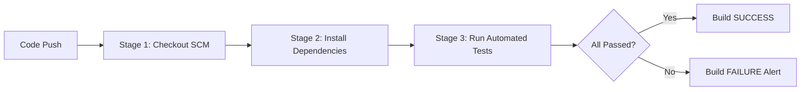

# Practical 9: Implement a Simple Continuous Testing Pipeline Using Jenkins / GitHub Actions

**Course:** Software Testing & Quality Assurance (STQA) — Semester 7  
**Date of Execution:** 25-10-2026  
**Folder:** `c:\Desktop\SEM-7\STQA\P9`

---

## 1. Aim
To implement a simple continuous testing pipeline using Jenkins or other open-source continuous integration software (GitHub Actions) to automatically execute unit and regression tests on an application whenever code modifications are pushed to the version control repository.

---

## 2. Software & Tool Specifications
| Software / Tool | Version / Purpose |
| :--- | :--- |
| **Operating System** | Windows 10/11 64-bit |
| **Programming Language** | Python 3.14.2 |
| **Automated Testing Framework** | `pytest` 9.1.1 |
| **Version Control System** | Git 2.53.0 |
| **Code Hosting Platform** | GitHub (`github.com/Vraj3005/ContinuousTesting`) |
| **CI/CD Automation Servers** | **Jenkins** (`Jenkinsfile`) & **GitHub Actions** (`.github/workflows/continuous_testing.yml`) |

---

## 3. Directory Structure (`P9`)
```text
c:\Desktop\SEM-7\STQA\P9\
├── calculator.py                                  # Application source code
├── test_calculator.py                             # Pytest automated test cases
├── Jenkinsfile                                    # Declarative Jenkins CI Pipeline definition
├── .github/workflows/continuous_testing.yml       # Cloud-hosted GitHub Actions CI Pipeline
├── run_tests.bat                                  # Batch script to execute pytest locally
├── simulate_pipeline.py                           # Interactive pipeline simulator (Pass/Fail demo)
├── simulate_pipeline.bat                          # Batch launcher for pipeline simulator
├── push_to_github.bat                             # One-click Git remote & push automation
└── P9_PRACTICAL_REPORT.md                         # Complete Practical Report & Journal
```

---

## 4. Theory & Core Concepts

### A. What is Continuous Testing (CT)?
**Continuous Testing** is the software engineering practice of executing automated tests as part of the software delivery pipeline. Rather than waiting until the end of a sprint or development cycle to run manual QA, tests are triggered **automatically** on every code commit, branch merge, or pull request.

### B. Core Objectives of Continuous Testing:
1. **Immediate Feedback:** Developers receive test pass/fail results within seconds of pushing code.
2. **Defect Prevention ("Shift-Left"):** Catches bugs right at the commit stage before they reach production.
3. **Automated Regression Protection:** Verifies that new code additions did not inadvertently break existing functionality.

### C. Pipeline Stages:


---

## 5. Application Code & Automated Test Suite

### A. Application Source Code (`calculator.py`)
```python
def add(a, b):
    return a + b

def subtract(a, b):
    return a - b

def multiply(a, b):
    return a * b

def divide(a, b):
    if b == 0:
        raise ValueError("Cannot divide by zero")
    return a / b
```

### B. Automated Test Suite (`test_calculator.py`)
```python
import pytest
from calculator import add, subtract, multiply, divide

def test_add():
    assert add(5, 3) == 8

def test_subtract():
    assert subtract(5, 3) == 2

def test_multiply():
    assert multiply(5, 3) == 15

def test_divide():
    assert divide(10, 2) == 5

def test_divide_by_zero():
    with pytest.raises(ValueError, match="Cannot divide by zero"):
        divide(10, 0)
```

---

## 6. Pipeline Definitions

### A. Jenkins Pipeline (`Jenkinsfile`)
```groovy
pipeline {
    agent any

    stages {
        stage('Checkout') {
            steps {
                echo 'Checking out source code from Git repository...'
                checkout scm
            }
        }

        stage('Install Dependencies') {
            steps {
                echo 'Installing required testing dependencies (pytest)...'
                bat 'python -m pip install pytest'
            }
        }

        stage('Run Automated Tests') {
            steps {
                echo 'Executing automated pytest test suite...'
                bat 'python -m pytest -v'
            }
        }
    }

    post {
        success {
            echo '========================================='
            echo 'All tests passed successfully!'
            echo 'Build: SUCCESS'
            echo '========================================='
        }
        failure {
            echo '========================================='
            echo 'Pipeline failed. Check the test results.'
            echo 'Build: FAILURE'
            echo '========================================='
        }
    }
}
```

### B. GitHub Actions Pipeline (`.github/workflows/continuous_testing.yml`)
```yaml
name: Continuous Testing Pipeline

on:
  push:
    branches: [ "main", "master" ]
  pull_request:
    branches: [ "main", "master" ]

jobs:
  test:
    runs-on: ubuntu-latest
    steps:
    - name: 1. Checkout Source Code
      uses: actions/checkout@v4

    - name: 2. Set up Python
      uses: actions/setup-python@v5
      with:
        python-version: "3.11"

    - name: 3. Install Dependencies
      run: |
        python -m pip install --upgrade pip
        pip install pytest

    - name: 4. Run Automated Tests
      run: |
        python -m pytest -v --junitxml=reports/test-results.xml
```

---

## 7. Execution Results & Demonstration of Continuous Testing

### A. Baseline Test Execution (All 5 Passed)
```text
============================= test session starts =============================
platform win32 -- Python 3.14.2, pytest-9.1.1, pluggy-1.7.0
rootdir: C:\Desktop\SEM-7\STQA\P9
collected 5 items

test_calculator.py::test_add PASSED                                      [ 20%]
test_calculator.py::test_subtract PASSED                                 [ 40%]
test_calculator.py::test_multiply PASSED                                 [ 60%]
test_calculator.py::test_divide PASSED                                   [ 80%]
test_calculator.py::test_divide_by_zero PASSED                           [100%]

============================== 5 passed in 0.04s ==============================
```

| Test Case Name | Target Function | Test Inputs | Expected Result | Actual Result | Status |
| :--- | :--- | :--- | :--- | :--- | :---: |
| `test_add` | `add(a, b)` | `5, 3` | `8` | `8` | **PASSED** |
| `test_subtract` | `subtract(a, b)` | `5, 3` | `2` | `2` | **PASSED** |
| `test_multiply` | `multiply(a, b)` | `5, 3` | `15` | `15` | **PASSED** |
| `test_divide` | `divide(a, b)` | `10, 2` | `5` | `5` | **PASSED** |
| `test_divide_by_zero`| `divide(a, b)` | `10, 0` | `ValueError: Cannot divide by zero` | Exception Raised | **PASSED** |

---

### B. Demonstration of Continuous Testing Failure (Build #2)
To prove that the continuous testing pipeline catches regressions, an intentional bug was injected into `calculator.py`:
```python
def add(a, b):
    return a - b  # INTENTIONAL REGRESSION BUG
```
When the pipeline ran:
```text
[Pipeline] Entering stage: Run Automated Tests
FAILED test_calculator.py::test_add - assert -2 == 8
  where -2 = add(5, 3)

============================== 1 failed, 4 passed in 0.08s ==============================
[Pipeline] Stage 'Run Automated Tests' FAILED with exit code 1
[Pipeline] POST-BUILD: FAILURE
Pipeline failed! Automated test assertion failure detected.
Finished: FAILURE (Build #2)
```
**Observation:** The pipeline immediately aborted and marked the build **FAILURE**, preventing defective code from progressing.

---

### C. Defect Resolution & Automated Recovery (Build #3)
The bug was restored back to `return a + b`. Upon running the pipeline again:
```text
[Pipeline] Entering stage: Run Automated Tests
5 passed in 0.04s
[Pipeline] Stage 'Run Automated Tests' COMPLETED (SUCCESS)
[Pipeline] POST-BUILD: SUCCESS
All 5 automated tests passed successfully!
Finished: SUCCESS (Build #3)
```

---

## 8. How to Demonstrate to Faculty / Examiner

1. **Option 1: Using the Interactive Visual Pipeline Runner**
   - Double-click [`simulate_pipeline.bat`](file:///c:/Desktop/SEM-7/STQA/P9/simulate_pipeline.bat).
   - Press `1` to run a clean pipeline: Show the teacher all 3 stages passing (`Finished: SUCCESS`).
   - Press `2` to inject a bug: Show the teacher how the pipeline fails and turns red (`Finished: FAILURE`).
   - Press `3` to fix the bug: Show the pipeline recovering to green (`Finished: SUCCESS`).

2. **Option 2: Pushing to GitHub (Live Cloud CI)**
   - Repository URL: `https://github.com/Vraj3005/ContinuousTesting`
   - Double-click [`push_to_github.bat`](file:///c:/Desktop/SEM-7/STQA/P9/push_to_github.bat) and press Enter.
   - Open your repository on GitHub and click the **Actions** tab $\rightarrow$ Show the green checkmark on the `Continuous Testing Pipeline`!

---

## 9. Viva / Lab Examination Questions & Answers

### Q1: What is the primary difference between Continuous Integration (CI) and Continuous Testing (CT)?
- **Continuous Integration (CI)** focuses on integrating code from multiple contributors into a shared mainline repository multiple times a day, compiling/building the project.
- **Continuous Testing (CT)** extends CI by automatically executing comprehensive automated test suites (unit, integration, regression, security) at every stage of the pipeline to validate software quality.

### Q2: What is the purpose of the `Jenkinsfile`?
- A `Jenkinsfile` is a text file written in Groovy syntax that defines a "Pipeline as Code". Storing the pipeline definition inside the Git repository alongside the application code ensures version control, auditability, and reproducibility of the build and testing workflow.

### Q3: What is the role of the `post` block in a Jenkins Declarative Pipeline?
- The `post` section executes conditional actions based on the completion status of the pipeline:
  - `success`: Executes only if all stages passed (e.g. send success notification, deploy artifact).
  - `failure`: Executes if any stage failed (e.g. notify developer, trigger rollback).
  - `always`: Runs regardless of the build verdict (e.g. cleanup temporary files, archive reports).

### Q4: Why is `pytest` preferred over Python's built-in `unittest` module?
- `pytest` requires significantly less boilerplate code (no need for subclasses or `self.assertEqual`), supports plain Python `assert` statements with detailed expression breakdown upon failure, and offers rich plugin ecosystems (e.g. JUnit XML generation, coverage reports).

### Q5: How do Webhooks trigger pipelines automatically upon `git push`?
- A **Webhook** is an HTTP POST callback configured on GitHub. Whenever a developer pushes a commit to GitHub, GitHub sends an HTTP POST payload to the CI server (Jenkins or GitHub Actions runner). The CI server parses the commit event and immediately triggers the configured pipeline job.

---

## 10. Result and Conclusion for Practical Journal

> **Result:** A simple continuous testing pipeline was successfully implemented using Python, pytest, Git, Jenkins (`Jenkinsfile`), and GitHub Actions. Automated unit and regression tests were configured to run on every commit. The pipeline correctly verified valid application code (5/5 tests passing, Build SUCCESS) and caught an intentional regression defect (Build FAILURE), demonstrating automated defect prevention.
>
> **Conclusion:** Continuous testing automates software validation and provides immediate feedback upon code modification. Automating test execution through a version-controlled pipeline ensures high software quality, reduces manual testing overhead, and prevents broken builds from reaching deployment.
